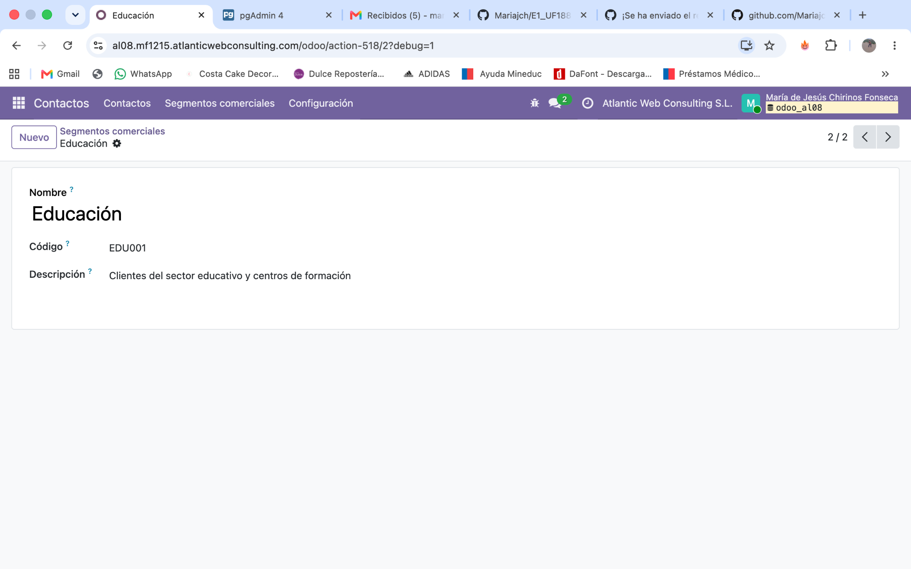
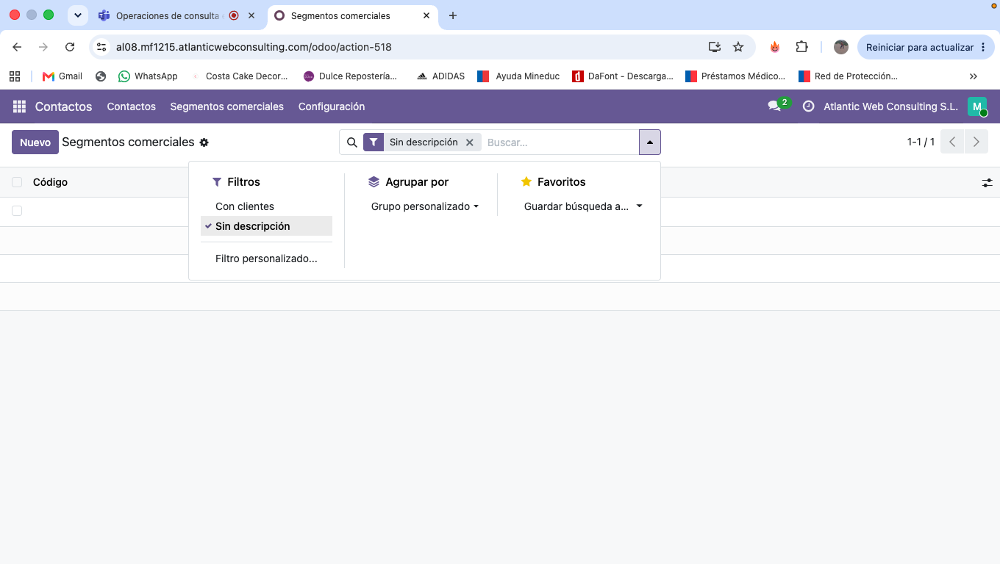
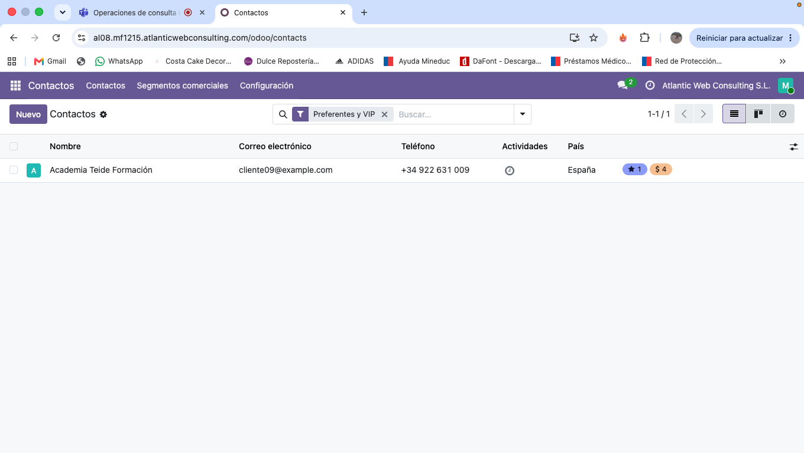

# Modificacion del diccionario de datos 

## Objetivo creado

Ampliar la informacion de los clientes para
permitir su clasificacion comercial mediante
campos personalizados.

## Modelo modificado

- Nombre funcional: Contactos / Clientes
- Modelo Odoo: res.partner
- Tabla PostgreSQL: res_partner

## Campos personalizados

### Nivel de cliente

- Nombre tecnico: x_nivel_cliente
- Tipo de campo: Seleccion
- Finalidad: Clasificar comercialmente al cliente.

### Segmento comercial

- Nombre tecnico: x_segmento_comercial_id
- Tipo de campo: Many2one
- Modelo relacionado: x_segmento_comercial
- Finalidad: Asociar cada cliente con un
  segmento de negocio.

## Modelo personalizado

- Nombre funcional: Segmento comercial
- Nombre tecnico: x_segmento_comercial
- Tabla PostgreSQL: x_segmento_comercial

Campos principales:
- id
- x_name
- x_codigo
- x_descripcion

## Modificacion de la vista

Se creo una vista heredada del formulario
res.partner.form para mostrar los campos
Nivel de cliente y Segmento comercial.

## Resultado

Se modifico el cliente Academia Teide Formacion,
asignandole:

- Nivel de cliente: Preferente
- Segmento comercial: Educacion

## 5. Evidencias de la modificacion

### Captura 1. Modelo Segmento comercial

### Captura 2. Campos personalizados

### Captura 3. Vista heredada

### Captura 4. Cliente modificado

### Creación del menú y mejora del formulario

Se creó una acción de ventana llamada "Segmentos comerciales",
asociada al modelo x_segmento_comercial.

Se añadió el menú "Segmentos comerciales" dentro de Contactos.

También se modificó la vista x_segmento_comercial.form
para mostrar los campos Nombre, Código y Descripción.

Se comprobó su funcionamiento abriendo el segmento
Educación, con código EDU001 y su descripción correspondiente.

## Creación de la vista de búsqueda y filtros

Se creó una vista de tipo Buscar para el modelo
x_segmento_comercial, con el nombre
x_segmento_comercial.search.

La vista permite buscar segmentos comerciales
por su nombre o código.

También se configuraron dos filtros personalizados:

- Con clientes: muestra los segmentos comerciales
  que tienen clientes asociados.
- Sin descripción: muestra los segmentos comerciales
  que no tienen una descripción registrada.

Se comprobó el funcionamiento de ambos filtros
desde Contactos → Segmentos comerciales.

### Evidencia del filtro Sin descripción

### Comprobación del filtro Preferentes y VIP

Se comprobó el funcionamiento del filtro "Preferentes y VIP" desde Contactos.

Al aplicar el filtro, Odoo mostró el contacto Academia Teide Formación, que tiene asignado el nivel de cliente Preferente.

La prueba confirma que el filtro funciona correctamente.

