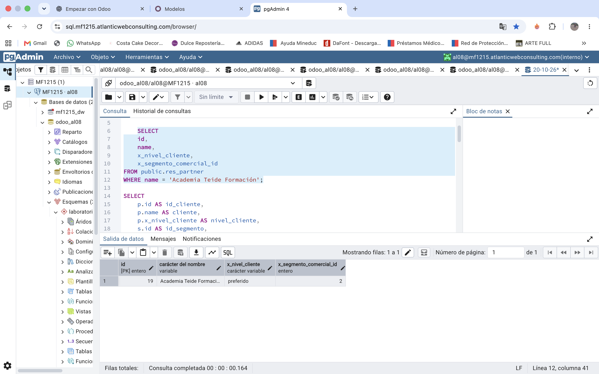
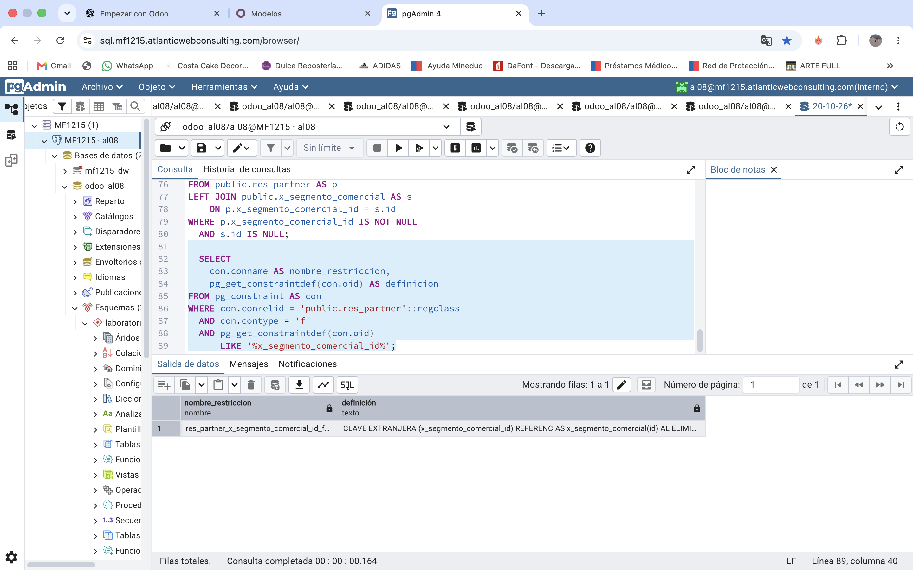

# Verificacion de los datos del cliente

Se realizo una consulta en PostgreSQL para
comprobar que los campos personalizados de
Odoo almacenan correctamente la informacion.

### Consulta SQL

```sql
SELECT
    p.id AS id_cliente,
    p.name AS cliente,
    p.x_nivel_cliente AS nivel_cliente,
    s.x_name AS segmento_comercial,
    s.x_codigo AS codigo_segmento
FROM public.res_partner AS p
LEFT JOIN public.x_segmento_comercial AS s
    ON p.x_segmento_comercial_id = s.id
WHERE p.id = 19;
```

### Resultado obtenido

- ID del cliente: 19
- Cliente: Academia Teide Formacion
- Nivel de cliente: preferido
- Segmento comercial: Educacion
- Codigo del segmento: EDU001

### Conclusion

La consulta permitio comprobar que los datos
personalizados se almacenan correctamente
en PostgreSQL y que existe una relacion entre
el cliente y su segmento comercial.

## Evidencia de la consulta

### Captura 5. Verificación de datos en PostgreSQL




## Verificación de integridad referencial

Se consultó el catálogo de restricciones de
PostgreSQL para comprobar la existencia de una
clave foránea entre las tablas res_partner y
x_segmento_comercial.

### Resultado de la comprobación

- Tabla de origen: res_partner
- Campo de relación: x_segmento_comercial_id
- Tabla de destino: x_segmento_comercial
- Campo referenciado: id
- Tipo de restricción: clave foránea

La consulta devolvió un registro que confirma
la existencia de la relación entre ambas tablas.

### Captura 6. Clave foránea en PostgreSQL



### Conclusión de integridad referencial

La clave foránea permite mantener la integridad
referencial entre los clientes y los segmentos
comerciales, evitando referencias a segmentos
que no existen en la tabla relacionada.

### Prueba de eliminación e integridad referencial

Se verificó en Odoo que el campo x_segmento_comercial_id del modelo res.partner está configurado como many2one, relacionado con el modelo x_segmento_comercial, y con la opción «Al eliminar: Restringir».

Se intentó realizar una prueba controlada de eliminación del segmento comercial con ID 2 mediante una transacción SQL.

## PostgreSQL devolvió el siguiente error:

ERROR: permission denied for table x_segmento_comercial

SQL state: 42501

El resultado indica que el usuario de PostgreSQL no dispone de permisos para ejecutar la eliminación. Por tanto, la prueba no permite confirmar directamente el comportamiento de la restricción ante un intento de borrado.

Posteriormente se ejecutó ROLLBACK; correctamente para cerrar la transacción.

Conclusión: se verificaron la configuración de la restricción en Odoo y la existencia de la clave foránea en PostgreSQL. La prueba de eliminación directa quedó limitada por los permisos del usuario.

